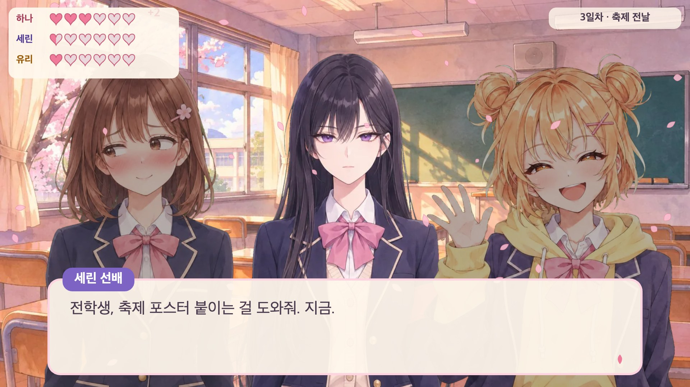
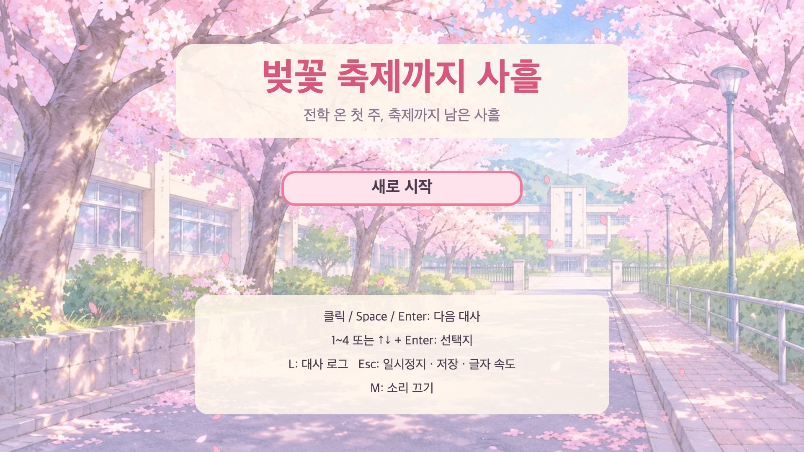
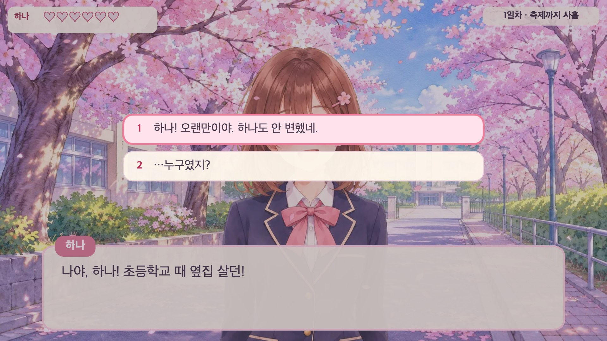
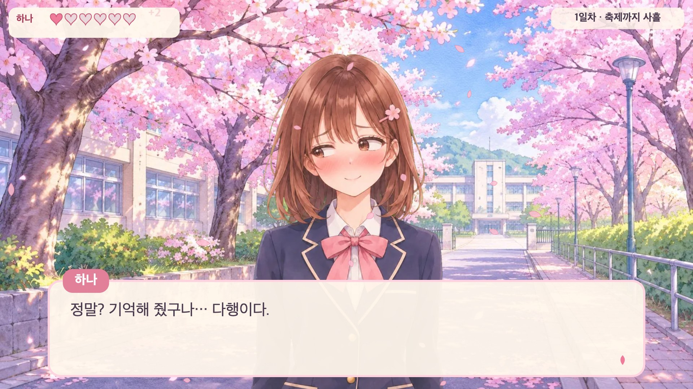
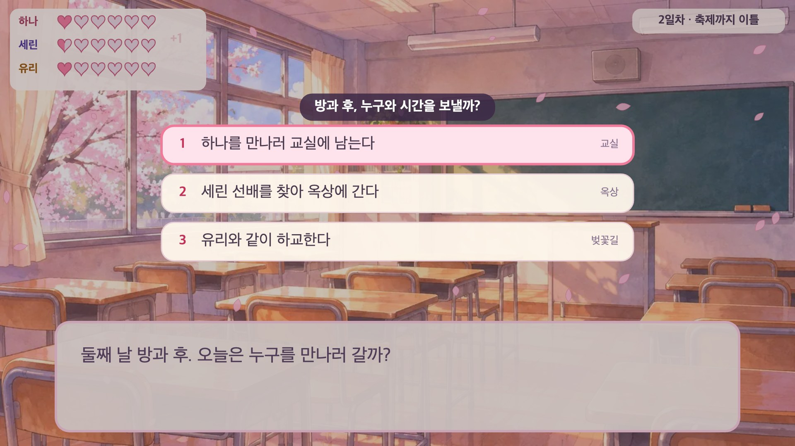
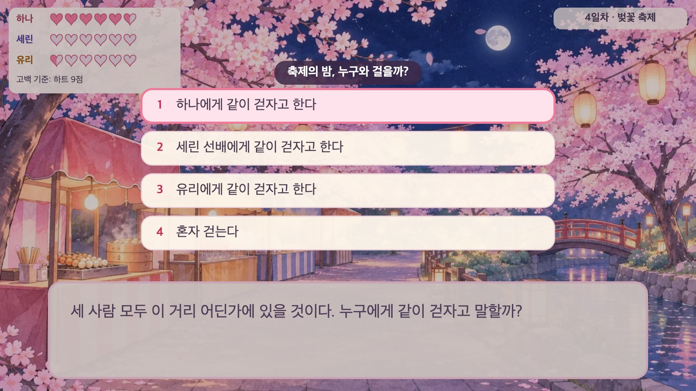
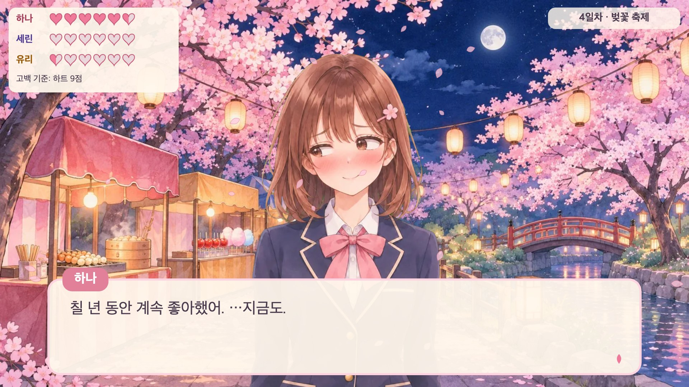
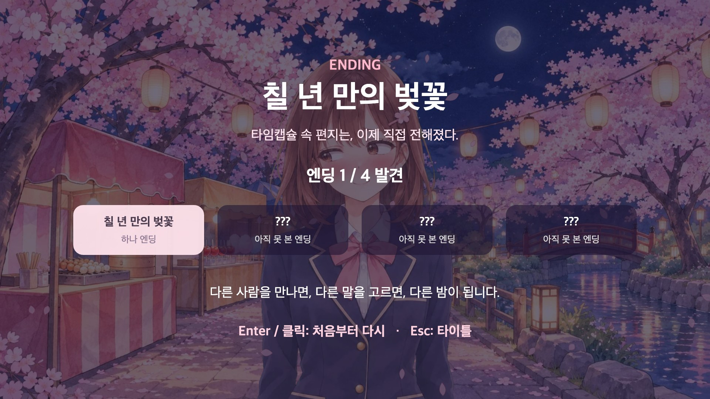

# 벚꽃 축제까지 사흘 (Sakura Week)

> 전학 온 첫 주, 벚꽃 축제까지 남은 사흘.
> 누구와 방과 후를 보낼지, 어떤 말을 건넬지. 한마디 한마디가 세 사람의 마음을 움직인다.



브라우저에서 바로 즐기는 짧은 연애 비주얼 노벨입니다. 한 판에 약 15분이 걸리고, 엔딩은 4개입니다.

## 게임 소개

벚꽃이 한창인 봄, 낯선 동네의 고등학교로 전학 온 첫날. 금요일 밤에는 벚꽃 축제가 열립니다. 축제까지 남은 사흘 동안 누구와 시간을 보내고 무슨 말을 할지는 당신의 선택에 달려 있습니다.

- **하나**: 칠 년 만에 다시 만난 소꿉친구. 상냥하고, 아직 보내지 못한 편지를 품고 있다.
- **세린 선배**: 늘 침착한 학생회장. 쉬는 법을 모르는, 옥상의 단골.
- **유리**: 교실을 잘못 찾아온 엉뚱한 후배. 시끄럽고, 꽃잎 소원을 믿는다.

## 특징

- **고르는 순간 반응합니다.** 대사를 고르면 표정이 바로 바뀌고 하트가 흔들리며, 다음 대사가 그 말에 답합니다.
- **한 말을 기억합니다.** 첫날 한 말이 사흘 뒤 축제의 밤에 다시 돌아옵니다.
- **마음을 얻어야 고백할 수 있습니다.** 축제 날에는 하트가 고백 기준을 넘은 사람만 함께 걸어 줍니다. 게임 오버는 없고, 어떤 길이든 엔딩에 닿습니다.
- **엔딩 4개.** 하나, 세린, 유리의 엔딩과 혼자 보는 벚꽃 엔딩이 있습니다. 다시 하면 아직 못 본 엔딩을 찾을 수 있습니다.
- **편하게 읽을 수 있습니다.** 글자 속도를 바꿀 수 있고, 지난 대사 로그를 볼 수 있습니다. 선택지마다 자동 저장되며, 캐릭터마다 목소리 효과음이 다릅니다.

## 스크린샷

| | |
|---|---|
|  |  |
|  |  |
|  |  |



## 조작

| 키 | 동작 |
|---|---|
| 클릭 / Space / Enter | 다음 대사 |
| 1~4, 또는 ↑↓ 후 Enter | 선택지 고르기 |
| L | 대사 로그 |
| Esc | 일시정지 (저장, 글자 속도, 타이틀로) |
| M | 소리 끄기·켜기 |

## 실행과 빌드

Node.js 22.12 이상이 필요합니다.

```bash
npm ci
npm run dev           # 개발 서버 (` 키로 값 조절 패널)
npm run build         # dist/ : 배포용 폴더 (itch.io, 웹사이트)
npm run build:single  # dist-single/index.html : 파일 하나로 된 빌드, 더블클릭으로 실행
npm test              # Vitest 단위 테스트 + Playwright 실행 테스트
```

밸런스 값(고백 기준, 하트 최대치, 글자 속도, 꽃잎 수 등)은 모두 `data/config.json`에 있습니다. 대본은 `src/game/story.ts`에 있습니다.

## 크레딧

- 기획, 대본, 코드: Claude Code ([Claude Code Game Studios](docs/STUDIO-README.md) 템플릿)
- 일러스트(배경 4장, 캐릭터 3명 × 표정 4종): Codex CLI 이미지 생성. 출처는 `assets/provenance.yaml`에 있습니다.
- 디자인 기록: `design/game-brief.md`
